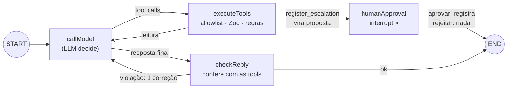

# Aurora — Assistente de suporte com aprovação humana

Desafio técnico Qwantyco. Assistente de suporte da empresa fictícia **Aurora**: consulta chamados, lista os abertos e prepara escalonamentos que **só são registrados depois de uma aprovação humana**, validada no backend.

**Stack:** TypeScript 5.9 (`strict`) · Next.js 16 (App Router) · React 19 · LangGraph 1.5 · LangChain Core 1.2 · Zod 4 · Vitest 5 · LangSmith · LLM local via Ollama (`qwen2.5:7b-instruct-q4_K_M`).

> **Estado:** todos os itens obrigatórios do desafio estão implementados, testados e revisados (ver [Mapa do desafio](#mapa-do-desafio)). O bônus (Assistants + RAG) não foi implementado. Andamento por passo em [`docs/plano.md`](docs/plano.md); requisitos e status em [`docs/requisitos.md`](docs/requisitos.md).

---

## Mapa do desafio

Onde cada parte do PDF está atendida e como verificar:

| Seção do desafio | Onde está | Como verificar |
|---|---|---|
| Três ferramentas, mocks e regra "só aberto escalona" | `src/agent/tools.ts`, `src/agent/domain/` | `tests/domain.test.ts`, `tests/approval.test.ts` (T02) |
| 01 Fluxo e estado (LangGraph, estado tipado, contratos, sessões) | `src/agent/graph.ts`, `executor.ts`, `domain/schemas.ts` | `tests/graph.test.ts` (T01, T07) |
| 02 Pausa e aprovação (interrupt, UI, validação no backend, idempotência) | `graph.ts` (`humanApproval`), `approval.ts`, `src/app/chat.tsx` | `tests/approval.test.ts` (T02–T04), `tests/api.test.ts`, UI |
| 03 Falhas e limites (falhas simuladas, timeout, tentativas, orçamento) | `faults.ts`, `run.ts`, políticas dos nós em `graph.ts` | `tests/limits.test.ts` (T05, T06), `SIMULATE_TOOL_FAILURE=… npm run smoke` |
| 04 LangSmith (traces com correlação, sem segredos) | `run.ts` (identidade do trace), `src/app/api/chat/http.ts` (envio) | `tests/tracing.test.ts`; projeto de tracing no LangSmith |
| 05 Evaluation (dataset, avaliador por código, experimento com modelo real) | `evals/` | `tests/evaluators.test.ts`, `npm run eval`, `npm run eval:demo` |
| 06 Cenários essenciais com modelo falso, separados da avaliação | `tests/` | `npm test` (117 testes, offline) |

---

## Instalação

**Pré-requisitos**
- Node **24 LTS** (fixado em `.nvmrc` e `engines`) e npm.
- [Ollama](https://ollama.com) rodando localmente, com o modelo baixado:
  ```bash
  ollama pull qwen2.5:7b-instruct-q4_K_M
  ```
- Conta gratuita no [LangSmith](https://smith.langchain.com), opcional: só é necessária para ver os traces.

**Passos**
```bash
nvm use
npm install
cp .env.example .env
```

Preencha o `.env`. Ele fica fora do git, e o `.env.example` não tem valores.

| Variável | Para quê | Exemplo |
|---|---|---|
| `OLLAMA_BASE_URL` | Endereço do Ollama | `http://localhost:11434` |
| `OLLAMA_MODEL` | Modelo usado pelo agente | `qwen2.5:7b-instruct-q4_K_M` |
| `LANGSMITH_TRACING` | Liga o envio de traces | `true` |
| `LANGSMITH_API_KEY` | Chave pessoal do LangSmith | — |
| `LANGSMITH_PROJECT` | Projeto onde os traces aparecem | `aurora` |
| `SIMULATE_TOOL_FAILURE` | Falhas simuladas (opcional; vazio = desligado) | `listar_chamados:error:2` |

Contas do LangSmith na região EU também precisam de `LANGSMITH_ENDPOINT=https://eu.api.smith.langchain.com`.

---

## Comandos de execução

```bash
# UI de chat em http://localhost:3000
npm run dev

# build de produção (inclui typecheck) e servidor
npm run build
npm start

# testes offline (modelo falso, sem rede)
npm test

npm run lint

# smoke manual com o modelo real: 7 conversas (listar, consultar, escalonar CH-101/CH-103/CH-102, status após aprovar)
npm run smoke

# smoke com falha simulada: cada chamada de listar_chamados falha 2 vezes e depois funciona
SIMULATE_TOOL_FAILURE=listar_chamados:error:2 npm run smoke

# avaliação no LangSmith com o modelo real (4 casos × 3 repetições, cerca de 2,5 min)
npm run eval

# experimentos de demonstração do avaliador (respostas fabricadas, sem modelo, segundos)
npm run eval:demo
```

Modos de falha: `error` (exceção transitória), `timeout` (a tool trava até o timeout) e `invalid_output` (saída fora do contrato). O formato é `tool:modo:vezes`, e várias falhas podem ser separadas por vírgula.

**Na UI**
- "Listar chamados abertos", "Consultar" e "Preparar escalonamento" (com o campo do identificador) enviam frases padronizadas. Texto livre também funciona.
- Quando o agente propõe um escalonamento, a UI mostra **a proposta exata** (chamado, resumo, justificativa) com **Aprovar** e **Rejeitar**, e bloqueia novas mensagens até a decisão.
- A sessão nasce na primeira mensagem (UUID gerado no navegador) e fica no estado da página, então recarregar começa uma sessão nova. Sessões diferentes não compartilham contexto.

**Massa de dados (fictícia):** CH-101 e CH-103 abertos; CH-102 e CH-104 resolvidos.

> Depois de alterar `src/agent/`, reinicie o `npm run dev`. O runtime (grafo, sessões e escalonamentos) fica em `globalThis` para sobreviver ao hot reload ([D35](docs/decisoes.md)).

---

## Testes offline

`npm test` roda o **mesmo grafo, executor e domínio** da aplicação, com o modelo trocado por `fakeModel()` (`@langchain/core/testing`). Os testes não usam rede nem LLM, e as falhas são injetadas de forma determinística. O tracing fica desligado no `vitest.config.mts`, então nenhum teste envia dados ao LangSmith.

| Arquivo | O que cobre |
|---|---|
| `tests/domain.test.ts` | Massa, contratos Zod, tools como funções puras, "só chamado aberto escalona", idempotência do store |
| `tests/graph.test.ts` | Tool call executada com os argumentos do modelo e resposta baseada no retorno; allowlist; argumentos inválidos; contexto por sessão e isolamento entre sessões (T01, T07) |
| `tests/approval.test.ts` | `interrupt` e retomada; rejeitar não grava; aprovar registra a proposta exibida; aprovação repetida não duplica; CH-102 bloqueado no backend (T02–T04) |
| `tests/limits.test.ts` | Retry de falha transitória, timeout por tentativa, limite de passos e de tempo, saída inválida descartada, espera humana fora do orçamento (T05, T06) |
| `tests/api.test.ts` | Rotas Next.js chamadas direto: códigos HTTP, proposta pendente (409), sessões isoladas, envio de traces agendado |
| `tests/guard.test.ts` | Guard da resposta final: afirmação sem ação, dado sem fonte, pedido de escalonamento ignorado |
| `tests/tracing.test.ts` | Árvore de runs enviada ao LangSmith (capturada em memória): nome, tags e metadata da mensagem e da retomada; nós, modelo e tool com args e resultado |
| `tests/evaluators.test.ts` | Avaliador da avaliação: aprova a execução correta e reprova consulta pulada, chamado inventado ou omitido, argumento errado, consulta com falha e efeito colateral; caso adicional pelo grafo, com a aprovação feita por código; busca por cliente, incluindo o id chutado que passa pelo guard; sincronização do dataset e demonstrações |

---

## Observabilidade (LangSmith)

Com `LANGSMITH_TRACING=true`, cada execução do agente gera um trace no projeto definido em `LANGSMITH_PROJECT`:

- **`aurora_message`** (tags `aurora`, `message`): uma mensagem do usuário. Mostra os nós `callModel` (com a chamada ao `ChatOllama`: mensagens, tool calls e modelo), `executeTools` (com cada tool, seus argumentos e resultado) e `checkReply`.
- **`aurora_resume`** (tags `aurora`, `resume`): a retomada depois da decisão humana. A entrada é o `Command` com a decisão, a metadata traz o `proposta_id`, e a saída tem o resultado real do registro.
- **Sessão:** todos os traces levam o `thread_id` da sessão, então mensagem e retomada aparecem juntas na aba **Threads**.
- **Falhas:** cada tentativa com erro aparece como um `executeTools` com status de erro e a mensagem, seguido da tentativa bem-sucedida.
- **Aprovação:** no trace da mensagem, o nó `humanApproval` aparece como erro. É o `interrupt` do LangGraph, que pausa o grafo lançando `GraphInterrupt` com a proposta; o trace como um todo fica `success`.
- **Sem segredos:** o SDK não anexa a chave da API aos traces, e isso foi conferido nos traces reais ([D44](docs/decisoes.md)). Nas rotas, o envio é concluído com `after()` depois da resposta, sem atrasar o usuário ([D42](docs/decisoes.md)).

---

## Avaliação (LangSmith)

O código fica em [`evals/`](evals/). Precisa do Ollama rodando e de `LANGSMITH_API_KEY` no `.env`.

**Dataset** (`evals/dataset.ts`)
| Caso | Mensagens | O que se espera |
|---|---|---|
| Obrigatório | "Liste todos os chamados abertos." | `listar_chamados` executada com `{"situacao":"aberto"}`, com sucesso; resposta com CH-101 e CH-103, sem omissões, extras ou invenções |
| Adicional | "Consulte o CH-101 e prepare um escalonamento se ele estiver aberto." → **aprovação** → "O CH-101 já foi escalonado?" | Escalonamento registrado; resposta de acordo com o campo `escalonamento` do último resultado de tool, sem ids sem fonte |
| Busca por cliente | "qual o chamado da Padaria?" e "Qual é o chamado da Transportadora Rota Sul?" | O chamado esperado (CH-101 e CH-103) veio de uma tool com aquele cliente, e a resposta cita só ele |

Os casos adicionais reproduzem problemas reais encontrados testando a UI:
- depois de aprovar, o modelo dizia que o chamado "ainda não foi escalonado" ([D38](docs/decisoes.md));
- perguntando pelo cliente, ele não identificava o chamado ou **chutava o CH-101**, o id usado como exemplo na descrição do `get_ticket` ([D51](docs/decisoes.md)).

O dataset cresce assim: uma falha observada vira um caso, a falha é medida, corrigida e medida de novo.

**Target** (`evals/target.ts`): roda cada caso num runtime novo, pelas mesmas portas de entrada da UI. Quando o grafo pausa para aprovação, o target faz o papel do humano e decide por código, passando pela mesma validação de backend. Ele devolve um registro do que **de fato executou**, tirado do estado do grafo: tool calls, resultados das tools, proposta, decisão e escalonamentos registrados.

**Avaliador por código** (`evals/evaluators.ts`): dá uma nota 0/1 por critério, com comentário, mais `pass`.
- **Obrigatório:** `tool_called`, `tool_succeeded`, `tool_matches_reference`, `answer_matches_tool` e `no_side_effects`.
- **Adicional:** `escalation_registered`, `answer_matches_status` e `answer_ids_backed`.
- **Busca por cliente:** `ticket_found_by_tool`, `answer_identifies_ticket`, `answer_ids_backed` e `no_side_effects`.

O avaliador lê os resultados das tools, que só existem se o executor executou a tool. Por isso, uma resposta com o texto certo mas **sem a consulta reprova**, e uma resposta que **inventa um chamado reprova**. As duas situações são demonstradas offline em `tests/evaluators.test.ts` e no LangSmith com `npm run eval:demo`.

**Como rodar**
- `npm run eval`:
  1. sincroniza o dataset `aurora-suporte` com `evals/dataset.ts`, criando os casos novos e removendo os que saíram do código;
  2. roda o experimento `aurora-<modelo>-…` com o modelo real, **3 repetições por caso**, um caso por vez.
- `npm run eval:demo`: roda dois experimentos **rotulados como demonstração**, só com o caso obrigatório e com respostas fabricadas, que não são o agente:
  - `demo-pula-consulta`: o texto certo, sem nenhuma tool;
  - `demo-inventa-chamado`: a tool executada de verdade, mas a resposta cita CH-105.

**Modelo e configuração do experimento (registrados na metadata)**
| Item | Valor |
|---|---|
| Modelo | `qwen2.5:7b-instruct-q4_K_M` (local, via Ollama; definido em `OLLAMA_MODEL`) |
| Parâmetros | `temperature: 0` |
| Limites | 12 passos e 120 s por invocação; tool com 5 s e 3 tentativas; modelo com 60 s e 2 tentativas |
| Repetições | 3 por caso, um caso por vez |
| Código | Commit do git (o LangSmith registra automaticamente, inclusive se há mudanças não commitadas) |

**Como conferir no LangSmith**
1. **Datasets & Experiments → `aurora-suporte`**:
   - aba **Examples**: os casos e o gabarito;
   - aba **Experiments**: cada execução, com a média de cada critério.
2. **Abra um experimento:** uma linha por execução de caso e uma coluna por critério (`tool_called`, `answer_matches_tool`, …, `pass`). Clique na nota para ver o comentário, por exemplo *"na resposta: CH-101, CH-103; omitidos: nenhum; extras ou inventados: nenhum"*.
3. **Clique numa linha:** abre o trace completo do agente naquela execução, com modelo, nós, tool, argumentos e resultado, e no caso adicional também a aprovação e a retomada.
4. **Compare** o experimento real com os de demonstração: o real fica com `pass` = 1; `demo-pula-consulta` reprova em `tool_called`, e `demo-inventa-chamado` em `answer_matches_tool`.

**Resultado de referência** (2026-10-22, experimento `aurora-qwen2.5:7b-instruct-q4_K_M-a3a9f02f`, commit `adc324e`): **6/12 `pass`**.

| Caso | `pass` | Critérios que falharam |
|---|---|---|
| Obrigatório (listar abertos) | 3/3 | — |
| Adicional (status após aprovação) | 3/3 | — |
| Busca: "qual o chamado da Padaria?" | 0/3 | `answer_identifies_ticket`: a lista trouxe o CH-101, mas a resposta descreve os dois chamados sem dizer qual é |
| Busca: "Qual é o chamado da Transportadora Rota Sul?" | 0/3 | `ticket_found_by_tool` e `answer_identifies_ticket`: o modelo consulta o CH-101 (id do exemplo da tool) e responde que é da Transportadora |

As falhas da busca por cliente são uma **limitação conhecida e mantida de propósito** no dataset: elas registram o problema medido (ver Limitações e [D51](docs/decisoes.md)). No caso adicional, a resposta "já foi escalonado" veio do resultado da aprovação no histórico, sem nova consulta. Com `temperature: 0`, as repetições saem idênticas. Isso mostra que os cenários aprovados são estáveis, mas não que o modelo seja robusto a texto livre.

---

## Fluxo



1. A UI chama `POST /api/chat`. A rota valida o corpo (Zod) e chama o core (`src/agent/`), que nunca importa `next`.
2. O modelo **só emite tool calls**. Quem executa é o **executor**, depois de validar a allowlist, os argumentos (Zod) e as regras de negócio. A saída da tool também é validada antes de voltar ao modelo.
3. `register_escalation` **nunca executa direto**: vira uma proposta `prop-<uuid>`, e o grafo pausa com `interrupt`.
4. A decisão chega por `POST /api/chat/decision`. O backend confere se ela corresponde à proposta pendente **daquela sessão** e só então retoma o grafo (`Command({ resume })`), que roda as regras de novo e registra.
5. A confirmação do registro é montada pelo código a partir do resultado real, não pelo modelo.

Diagramas completos (camadas, arquivos, sequências de consulta, aprovação e falha, e a árvore dos traces) estão em [`docs/fluxo.md`](docs/fluxo.md).

### Onde cada regra de negócio é garantida

| Regra | Onde |
|---|---|
| Só chamado aberto pode ser escalonado | `checkEscalationAllowed` no executor (antes de virar proposta) e de novo no `registerEscalation` (no registro) |
| Nada é registrado sem aprovação | `register_escalation` vira proposta; o registro só acontece no nó `humanApproval` |
| Aprovação vinculada à proposta | `decideProposal` confere a proposta pendente da sessão e o `proposta_id`; a decisão é validada por Zod |
| Aprovar de novo não duplica | Store idempotente por `proposta_id`; chamado já escalonado não é escalonado de novo |
| Não inventar dados nem confirmar o que não ocorreu | Respostas a partir do retorno das tools; confirmação determinística; guard `checkReply` |
| Não depender só do prompt | Allowlist, Zod e regras no executor e no domínio |
| Limites de execução | Retry e timeout por nó; no máximo 12 passos e 120 s por invocação; a espera humana não conta |

### Estrutura de pastas
```
src/app/            UI (chat.tsx) e rotas de API finas (api/chat, api/chat/decision)
src/agent/          core: grafo, executor, aprovação, limites, guard, modelo, tools
src/agent/domain/   massa mockada, contratos Zod, regras e store de escalonamentos
evals/              avaliação: dataset, target e avaliador por código
tests/              testes offline (Vitest + fakeModel)
scripts/            smoke manual com o modelo real
docs/               plano, requisitos, decisões e fluxo
```

---

## Decisões

Todas as decisões, com contexto, opções e motivo, estão em [`docs/decisoes.md`](docs/decisoes.md) (D01–D51). As principais:

- **LLM local via Ollama** (D07, D25, D39): sem custo e sem chave de API. O `qwen2.5:7b` foi escolhido num smoke comparativo de tool calling.
- **Executor próprio em vez de `ToolNode`/`createAgent`** (D23): a validação de allowlist, argumentos, regras e saída fica explícita e num lugar só.
- **Aprovação num nó dedicado com `interrupt`** (D26–D28): nada com efeito colateral roda antes do `interrupt`, a decisão passa por três barreiras no backend, e a confirmação é determinística.
- **Idempotência por proposta e bloqueio por chamado** (D11).
- **Escalonamento em coleção separada** (D19, D38): o chamado não muda. As tools de leitura devolvem o chamado com o campo `escalonamento`, que é a fonte de verdade para "já foi escalonado?".
- **Retry e timeout nativos do LangGraph e orçamento por invocação** (D29, D30): erros de negócio são dados e nunca são retentados.
- **Guard da resposta final** (D40): confere o texto contra as tool calls e os resultados.
- **Tracing** (D42–D44): identidade de cada execução, envio garantido com `after()` e nenhum segredo nos traces.
- **Avaliação** (D45–D50): `evaluate()` do LangSmith, dataset sincronizado com o código, 3 repetições e demonstrações rotuladas; o avaliador lê o registro do que executou, não o texto do modelo; o caso adicional passa por uma aprovação feita por código.

---

## Limitações

- **Modelo pequeno (7B):** o tool calling fica no limite em conversas longas e com texto livre. Às vezes o modelo responde a partir do histórico em vez de consultar de novo, ou descreve uma ação sem chamá-la. O guard (`checkReply`) corrige ou substitui por uma mensagem honesta, mas não elimina o problema; a correção de raiz seria um modelo maior (risco registrado em D39). Os botões da UI usam as frases mais estáveis nas medições.
- **O guard depende de padrões de texto em PT** para duas das três checagens: uma redação nova pode escapar. Cada caso encontrado vira teste.
- **Estado em memória:** sessões (`MemorySaver`) e escalonamentos se perdem quando o servidor reinicia. É um processo só, sem banco nem fila.
- **Sem autenticação:** a sessão é um UUID gerado pelo navegador. O backend isola sessões entre si, mas não identifica usuários.
- **Uma proposta pendente por vez** em cada sessão; mensagens novas são recusadas (409) até a decisão.
- **Busca por cliente (conhecida, medida e não corrigida):** nenhuma tool busca por nome de cliente. Numa conversa nova, o 7B tende a listar todos os chamados sem dizer qual é o do cliente, ou a **chutar o CH-101**, o id usado como exemplo na descrição do `get_ticket`. Exemplo: "Qual é o chamado da Transportadora Rota Sul?" → "é o CH-101" (o certo é o CH-103). Os dois casos de busca por cliente da avaliação registram essa falha. Correções possíveis estão em [D51](docs/decisoes.md).
- **Avaliação com poucos casos e frases fixas:** o resultado vale para esses cenários. O avaliador confere os "dados inventados" pelos ids de chamado e escalonamento; um título ou cliente errado no texto livre não é detectado ([D46](docs/decisoes.md)).
- Só dados fictícios; sem deploy público.
