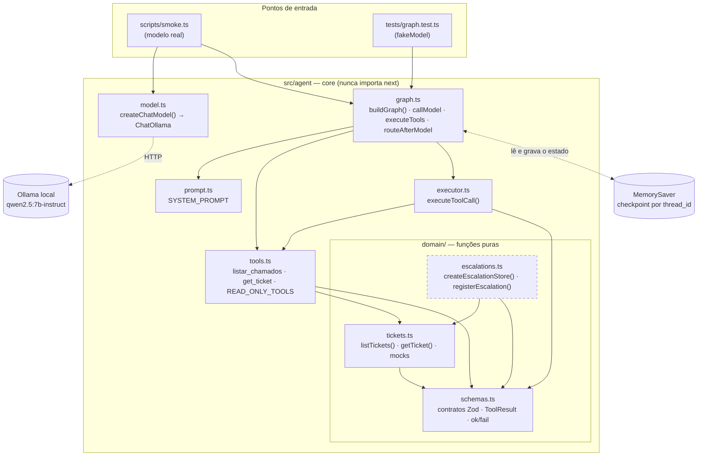
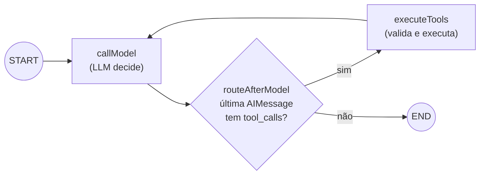
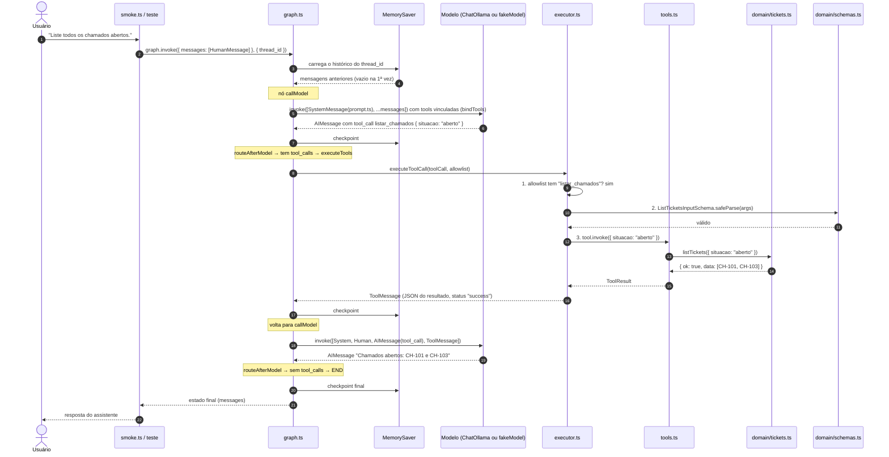
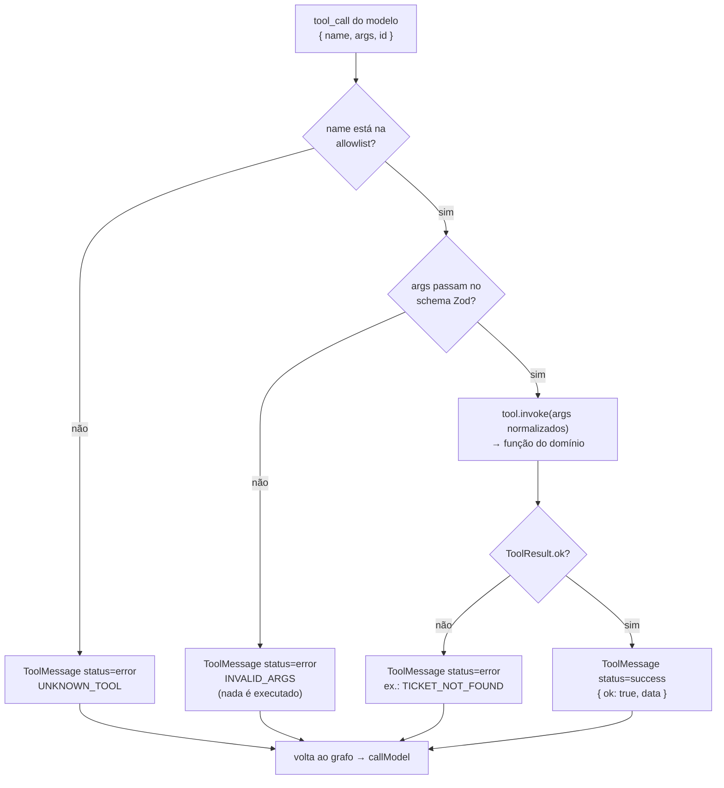

# Fluxo de execução

Mostra **quem chama quem** entre os arquivos quando o assistente roda. Atualizado ao fim de cada passo.
Os diagramas são Mermaid (renderizam no GitHub e no preview de Markdown do VS Code).

**Estado atual:** Passo 3. O grafo consulta chamados; o escalonamento com aprovação entra no Passo 4.

---

## 1. Mapa de arquivos (quem importa/chama quem)

> `escalations.ts` (tracejado) existe e é testado em `tests/domain.test.ts`, mas **ainda não é chamado pelo grafo**. Ele entra no Passo 4, com a aprovação humana.
>
> O teste não usa `model.ts`: injeta o `fakeModel()` direto no `buildGraph`. O grafo e o executor são os mesmos nos dois casos.

---

## 2. O grafo (nós e arestas do LangGraph)

O loop `callModel → executeTools → callModel` se repete até o modelo responder sem pedir tools.

---

## 3. Sequência completa: "Liste todos os chamados abertos."

Pontos-chave:
- O **modelo nunca executa nada**: ele só devolve uma `AIMessage` com a intenção (nome + argumentos).
- Quem executa é o **executor**, depois de validar. O resultado volta ao modelo como `ToolMessage`, e a resposta final é baseada nele.
- O **MemorySaver** guarda o estado por `thread_id`. Na próxima mensagem da mesma sessão, o histórico é carregado no início do `invoke`.

---

## 4. Decisões dentro do executor (`executeToolCall`)

Allowlist atual: `listar_chamados`, `get_ticket`. O `register_escalation` **não** está nela até o Passo 4, então chamá-lo hoje retorna `UNKNOWN_TOOL`.

---

## Histórico de atualizações

| Passo | O que mudou no fluxo |
|-------|----------------------|
| 2 | Domínio isolado: `tickets.ts`, `escalations.ts` e `schemas.ts`, chamados só pelos testes. |
| 3 | Grafo `callModel ⇄ executeTools`, executor com allowlist + Zod, tools do LangChain, checkpointer por `thread_id`, entradas `smoke.ts` e testes. |
