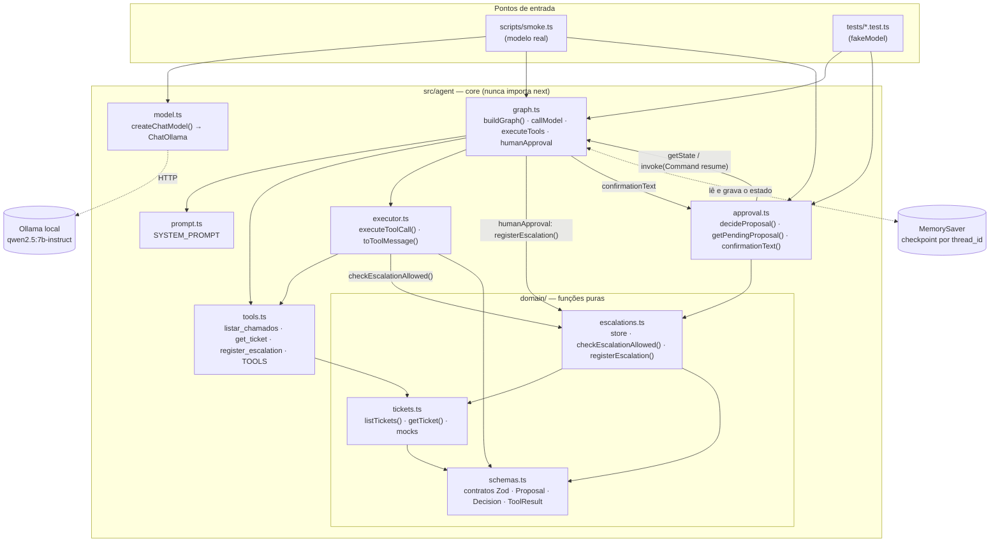
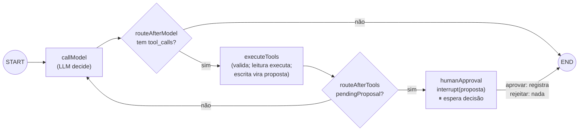
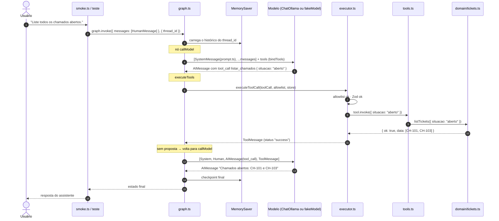
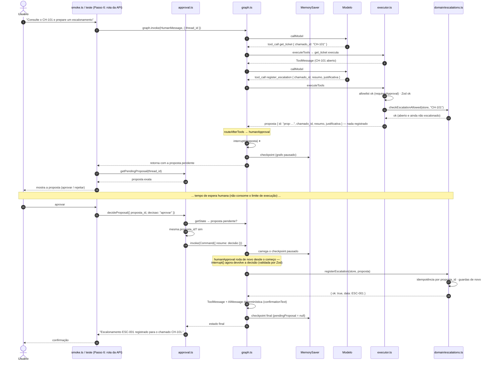
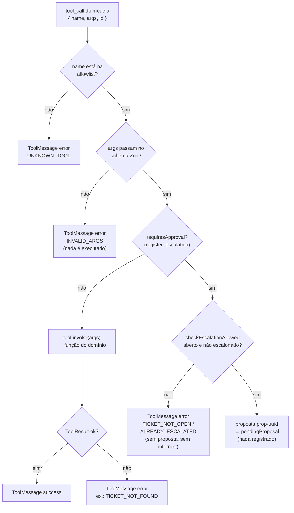
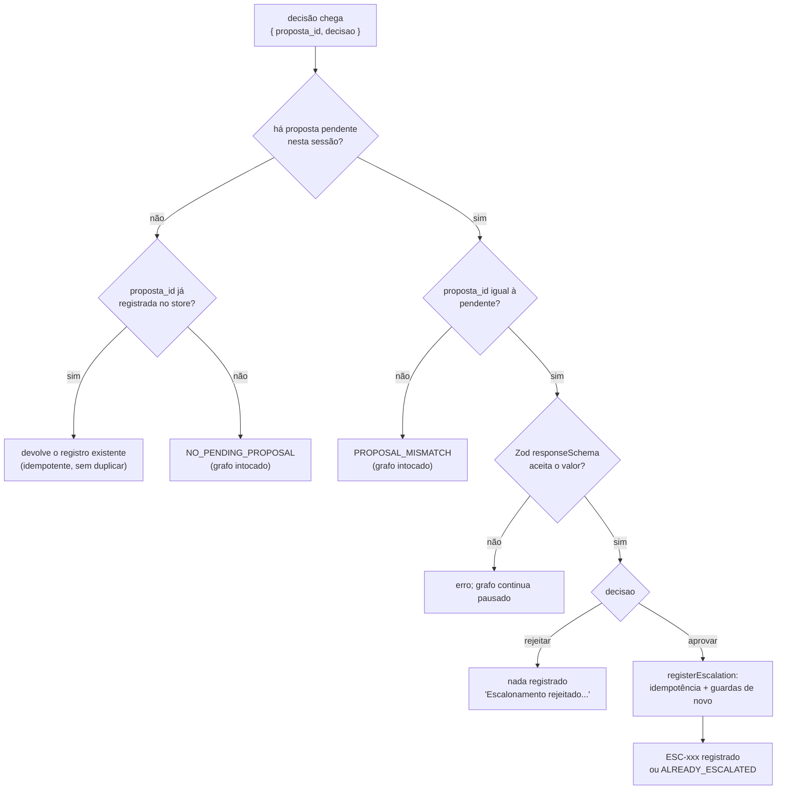

# Fluxo de execução

Mostra **quem chama quem** entre os arquivos quando o assistente roda. Atualizado ao fim de cada passo.
Os diagramas são Mermaid (renderizam no GitHub e no preview de Markdown do VS Code).

**Estado atual:** Passo 4. O grafo consulta chamados e prepara escalonamentos que pausam para aprovação humana. A API Next.js entra no Passo 6.

---

## 1. Mapa de arquivos (quem importa/chama quem)

> O teste não usa `model.ts`: injeta o `fakeModel()` direto no `buildGraph`. O grafo, o executor e o domínio são os mesmos nos dois casos.
>
> `approval.ts` é a porta de entrada da **decisão humana**: no Passo 6, a rota da API vai chamar `decideProposal()` em vez do `smoke.ts`.

---

## 2. O grafo (nós e arestas do LangGraph)

Estado (`AgentState`): `messages` (histórico) + `pendingProposal` (proposta aguardando decisão, ou `null`).

---

## 3. Sequência: consulta simples ("Liste todos os chamados abertos.")

Pontos-chave:
- O **modelo nunca executa nada**: ele só devolve uma `AIMessage` com a intenção (nome + argumentos).
- Quem executa é o **executor**, depois de validar. O resultado volta ao modelo como `ToolMessage`, e a resposta final é baseada nele.
- O **MemorySaver** guarda o estado por `thread_id`. Na próxima mensagem da mesma sessão, o histórico é carregado no início do `invoke`.

---

## 4. Sequência: escalonamento com aprovação ("Consulte o CH-101 e prepare um escalonamento")

São **duas chamadas** ao grafo: a primeira pausa no `interrupt`; a segunda (a decisão humana) retoma do ponto salvo no checkpoint.

Se a decisão for **rejeitar**, o passo `registerEscalation` não acontece e a mensagem é "Escalonamento rejeitado. Nada foi registrado."

---

## 5. Decisões dentro do executor (`executeToolCall`)

---

## 6. Barreiras da decisão humana (`decideProposal` → `humanApproval` → store)

---

## Histórico de atualizações

| Passo | O que mudou no fluxo |
|-------|----------------------|
| 2 | Domínio isolado: `tickets.ts`, `escalations.ts` e `schemas.ts`, chamados só pelos testes. |
| 3 | Grafo `callModel ⇄ executeTools`, executor com allowlist + Zod, tools do LangChain, checkpointer por `thread_id`, entradas `smoke.ts` e testes. |
| 4 | Nó `humanApproval` com `interrupt`, campo `pendingProposal` no estado, `register_escalation` vira proposta no executor, `approval.ts` (`decideProposal`) valida e retoma, store idempotente por `proposta_id`, confirmação determinística. |
