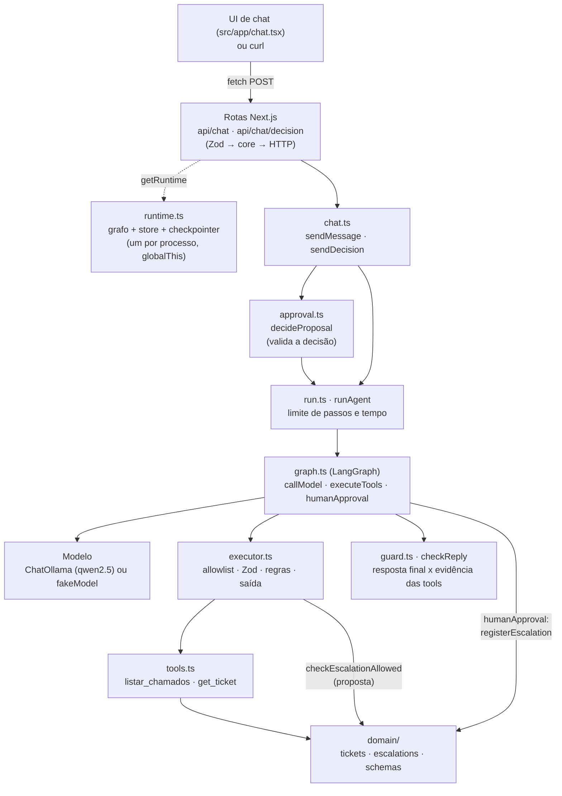
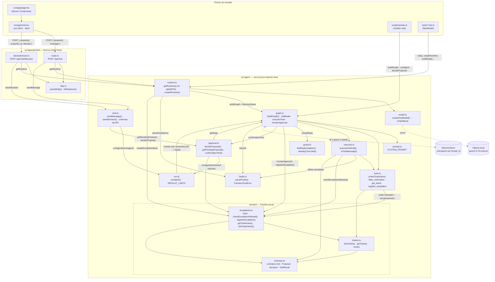
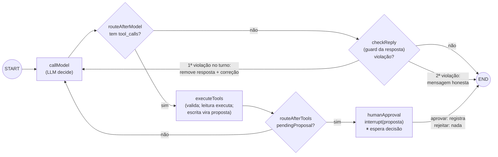
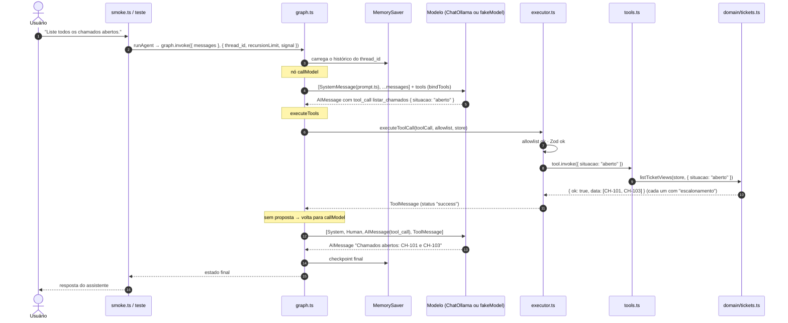
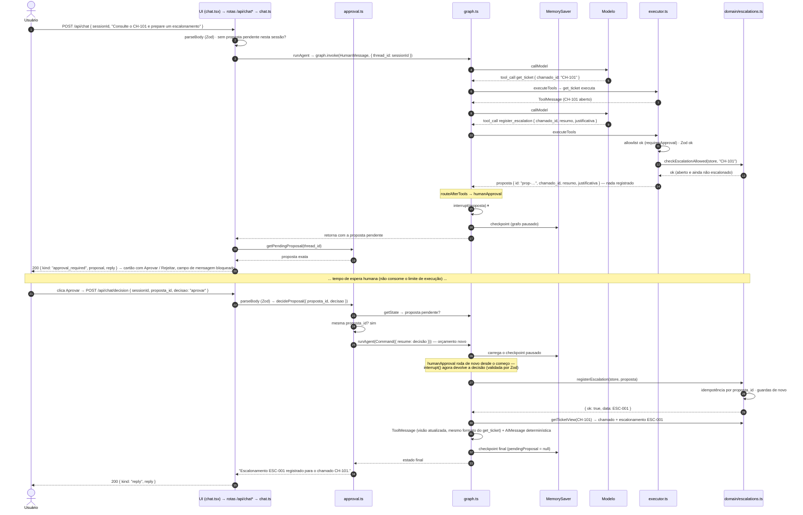
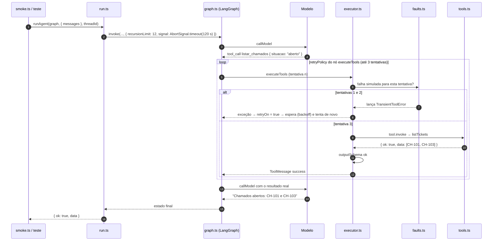
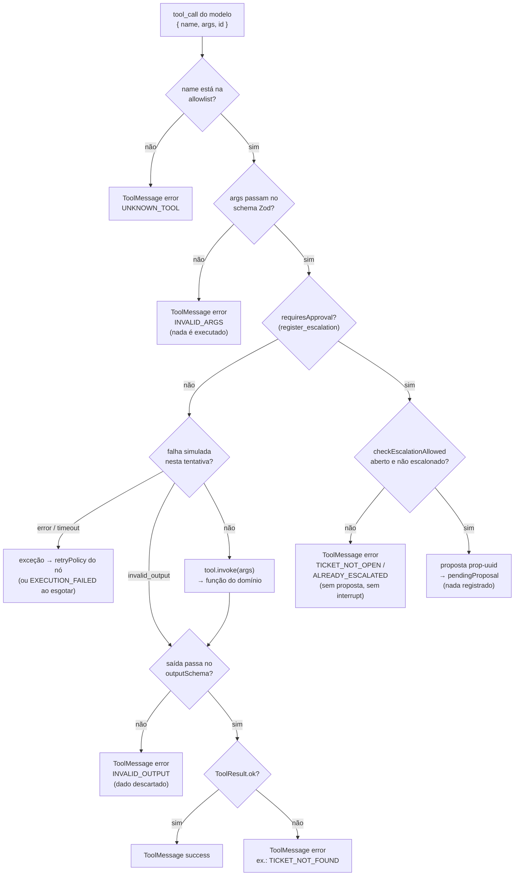
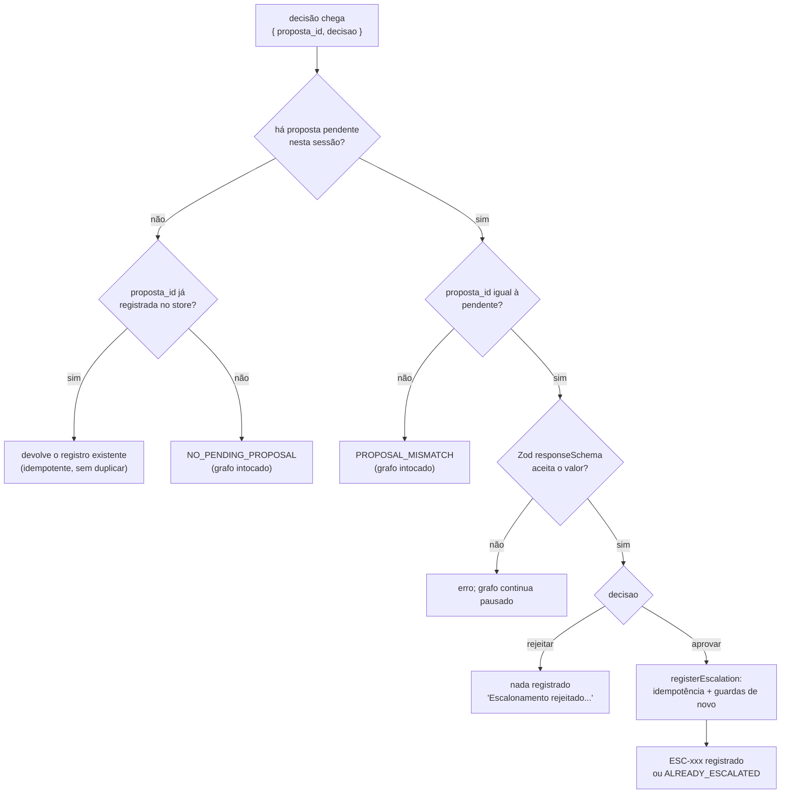

# Fluxo de execução

Mostra **quem chama quem** entre os arquivos quando o assistente roda. Atualizado ao fim de cada passo.
Os diagramas são Mermaid (renderizam no GitHub e no preview de Markdown do VS Code).

**Estado atual:** Passo 7 (com ajustes D38, D40 e D41). A UI de chat (`src/app/chat.tsx`) usa a API Next.js (`/api/chat` e `/api/chat/decision`), que expõe o agente: consulta, escalonamento com aprovação humana, retry, timeout e limites. O tracing no LangSmith entra no Passo 8.

---

## 1. Visão em camadas (caminho de uma requisição)

Leitura de cima para baixo: cada camada só conhece a de baixo. As regras de negócio ficam em `domain/` e no executor, nunca nas rotas nem no prompt.

---

## 2. Mapa detalhado de arquivos (quem importa/chama quem)

> As **rotas** só validam o corpo (Zod), chamam `chat.ts` e traduzem o resultado em HTTP. Nenhuma regra de negócio fica nelas.
>
> `runtime.ts` guarda **um** grafo, store e checkpointer por processo em `globalThis`, para o hot reload do `next dev` não apagar as sessões. Os testes trocam o modelo por `fakeModel()` com `setRuntimeForTests()`. O grafo, o executor e o domínio são os mesmos.
>
> `run.ts` é a porta de entrada de **toda execução**: aplica o limite de passos e de tempo por invocação e converte estouros em erro controlado.
>
> `approval.ts` é a porta de entrada da **decisão humana**, chamada pela rota de decisão via `chat.ts`.

---

## 3. O grafo (nós e arestas do LangGraph)

Estado (`AgentState`): `messages` (histórico) + `pendingProposal` (proposta aguardando decisão, ou `null`).

`checkReply` (D40) confere a resposta final contra as tools: (1) pedido de escalonamento explícito, chamado aberto e sem escalonamento no `get_ticket` do turno, mas sem `register_escalation`; (2) texto afirma proposta criada sem `register_escalation`; (3) cita `CH-xxx`/`ESC-xxx` que nenhuma tool retornou. No máximo uma correção por turno.

Políticas por nó (nativas do LangGraph, D29):

| Nó | Retry | Timeout por tentativa | Retenta quando |
|----|-------|-----------------------|----------------|
| `callModel` | até 2 tentativas | 60 s | qualquer erro, exceto abort |
| `executeTools` | até 3 tentativas (backoff 0,5 s → 1 s) | 5 s | `TransientToolError` ou `NodeTimeoutError` |
| `humanApproval` | — | — | — |

Por invocação (`runAgent`, D30): no máximo 12 passos e 120 s. A espera humana fica fora porque a pausa encerra a invocação.

---

## 4. Sequência: consulta simples ("Liste todos os chamados abertos.")

Pontos-chave:
- O **modelo nunca executa nada**: ele só devolve uma `AIMessage` com a intenção (nome + argumentos).
- Quem executa é o **executor**, depois de validar. O resultado volta ao modelo como `ToolMessage`, e a resposta final é baseada nele.
- O **MemorySaver** guarda o estado por `thread_id`. Na próxima mensagem da mesma sessão, o histórico é carregado no início do `invoke`.

---

## 5. Sequência: escalonamento com aprovação ("Consulte o CH-101 e prepare um escalonamento")

São **duas chamadas** ao grafo: a primeira pausa no `interrupt`; a segunda (a decisão humana) retoma do ponto salvo no checkpoint.

Se a decisão for **rejeitar**, o passo `registerEscalation` não acontece e a mensagem é "Escalonamento rejeitado. Nada foi registrado."

---

## 6. Sequência: falha transitória, retry e erro controlado

Exemplo com `SIMULATE_TOOL_FAILURE=listar_chamados:error:2` (cada chamada falha nas 2 primeiras tentativas).

Se as 3 tentativas falharem (`listar_chamados:error:3`), a exceção sai do grafo, e o `runAgent` devolve `{ ok: false, error: { code: "EXECUTION_FAILED" } }`. O modelo **não** é chamado de novo, então nenhuma resposta é inventada. Estouro de passos (`GraphRecursionError`) ou de tempo (abort) viram `EXECUTION_LIMIT`.

---

## 7. Decisões dentro do executor (`executeToolCall`)

---

## 8. Barreiras da decisão humana (`decideProposal` → `humanApproval` → store)

---

## Histórico de atualizações

| Passo | O que mudou no fluxo |
|-------|----------------------|
| 2 | Domínio isolado: `tickets.ts`, `escalations.ts` e `schemas.ts`, chamados só pelos testes. |
| 3 | Grafo `callModel ⇄ executeTools`, executor com allowlist + Zod, tools do LangChain, checkpointer por `thread_id`, entradas `smoke.ts` e testes. |
| 4 | Nó `humanApproval` com `interrupt`, campo `pendingProposal` no estado, `register_escalation` vira proposta no executor, `approval.ts` (`decideProposal`) valida e retoma, store idempotente por `proposta_id`, confirmação determinística. |
| 5 | `run.ts` (`runAgent`: limite de passos e tempo por invocação, erro controlado), `faults.ts` (falhas simuladas), `retryPolicy` e `timeout` nativos nos nós, validação de saída das tools (`outputSchema`) e tratamento de `invalid_tool_calls`. |
| 6 | Rotas `POST /api/chat` e `POST /api/chat/decision` (finas: Zod → core → HTTP), `chat.ts` (`sendMessage` recusa mensagem com proposta pendente, `sendDecision`), `runtime.ts` (runtime único em `globalThis`). |
| 7 | UI: `page.tsx` (Server Component) renderiza `chat.tsx` (`'use client'`), que chama as rotas com `fetch`, mostra o cartão da proposta e bloqueia o envio enquanto há proposta pendente. |
| 7 (ajuste) | Tools de leitura criadas por runtime (`createTools(store)`) e devolvendo a visão chamado + `escalonamento`; após a aprovação, o `ToolMessage` traz a visão atualizada (D38). Prompt reorganizado em passos. |
| 7 (ajuste 2) | Nó `checkReply` (`guard.ts`) após a resposta final: correção única ou mensagem honesta quando a resposta afirma ação não feita, cita dado sem fonte ou ignora pedido explícito de escalonamento (D40). UI com "Como usar" e ações rápidas (D41). |
